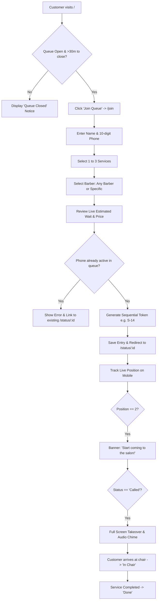

# Queue Management Flows & Business Rules — Salon Queue Management System

This document defines the core business logic, lifecycle states, assignment algorithms, wait-time calculations, and comprehensive test cases. All business logic must remain centralized to ensure parity across all client screens.

---

## 1. Customer Flows

### 1.1 Remote Customer Joining Flow


1. **Discovery & Verification**: Customer opens `/`, reviews live wait times, and clicks **"Join Queue"**.
2. **Form Entry & Validation**:
   - Customer enters full name and 10-digit mobile number.
   - Validation checks phone format (10 numeric digits) and rejects duplicates if already in `Waiting` or `Called` or `In Chair` status.
3. **Service & Barber Selection**:
   - Customer selects 1, 2, or maximum 3 services.
   - Customer chooses **"Any Barber (Fastest)"** or a specific barber (Ravi, Amit, Imran).
   - If a specific barber is on break, a prominent warning informs the customer of potential additional waiting.
4. **Token Generation & Persistence**:
   - System assigns the next daily sequential token (e.g., `S-14`).
   - Customer is redirected to `/status/:id`.
5. **Real-time Lifecycle Updates**:
   - Customer monitors real-time position countdown and dynamic wait time.
   - **Position #2 Alert**: When position drops to 2, banner informs customer: *"Start coming to the salon!"*.
   - **Call Notification**: When receptionist or barber clicks "Call Next", customer sees full-screen *"It's your turn!"* modal with sound chime.
6. **Self-Service Cancellation**: Customer can cancel their spot with a confirmation dialog before they are called or seated.

---

### 1.2 Walk-in Customer Flow
1. **Physical Arrival**: Customer walks into the salon and approaches the reception desk.
2. **Receptionist Entry**:
   - Receptionist opens `/reception` on tablet and taps **"+ Add Walk-in"**.
   - Receptionist enters customer name, phone number, services requested (max 3), and barber preference.
3. **Token Issuance**:
   - Walk-in is assigned the next sequential token with badge `Walk-in`.
   - Customer is told their token number and asked to watch the TV display (`/display`).
4. **TV & Ambient Tracking**:
   - TV display shows the customer's token in the "Next in Line" list.
   - When called, the TV flashes gold and sounds a chime, and the customer proceeds to the assigned chair.

---

## 2. Queue Status Lifecycle & State Machine

```
              ┌───────────────┐
              │    Waiting    │
              └───────┬───────┘
                      │
         ┌────────────┼────────────┐
         │ (Call Next)│            │ (Customer/Staff Cancel)
         ▼            │            ▼
   ┌───────────┐      │     ┌─────────────┐
   │  Called   │      │     │  Cancelled  │ (Terminal)
   └─────┬─────┘      │     └─────────────┘
         │            │
   ┌─────┴─────┐      │
   │ (Seat)    │ (No-show >10m)
   ▼           ▼
┌──────────┐ ┌──────────┐
│ In Chair │ │ No-show  │ (Terminal)
└────┬─────┘ └──────────┘
     │ (Done)
     ▼
┌──────────┐
│   Done   │ (Terminal)
└──────────┘
```

### Allowed Transitions & Strict Rules:
- **`Waiting → Called`**: Triggered by receptionist or barber via "Call Next". Customer assigned to free barber chair.
- **`Called → In Chair`**: Triggered when customer sits in chair and service starts (initiates barber stopwatch).
- **`In Chair → Done`**: Triggered when barber completes service. Chair becomes free.
- **`Waiting → Cancelled`**: Customer self-cancels or receptionist cancels. (Terminal state).
- **`Called → No-show`**: Customer fails to arrive within 10 minutes of being called. Receptionist marks No-show. (Terminal state).

### Absolute State Invariants:
1. **Never Backward**: Statuses must never transition backwards (e.g., `In Chair` cannot return to `Called` or `Waiting`).
2. **Terminal States**: `Done`, `Cancelled`, and `No-show` are immutable terminal states.
3. **One Active Customer Per Barber**: A barber chair can only have at most one customer in `Called` or `In Chair` status at any moment.

---

## 3. Barber Assignment & FIFO Rules

1. **First-Come, First-Served (FIFO)**:
   - Queue order is strictly based on creation timestamp (`createdAt` ascending).
2. **Preference Filtering**:
   - **Specific Barber**: If customer selected "Ravi", they can **only** be assigned to Ravi, regardless of whether Amit or Imran are free.
   - **Any Barber**: Can be assigned to the first barber who becomes free and triggers "Call Next".
3. **"Call Next" Eligibility Algorithm**:
   - When Barber $B$ (or Receptionist for Barber $B$) clicks **"Call Next"**:
     1. Search waiting list for the oldest customer with status `Waiting` whose `preferredBarber` is either $B$ or `'any'`.
     2. Assign that customer to Barber $B$.
     3. Transition customer status to `Called`.
     4. Set timestamp `calledAt = now()`.
     5. Barber $B$ status becomes `Busy`.
4. **Single Active Service**:
   - A barber cannot call next if they already have an active customer in `Called` or `In Chair`.

---

## 4. Dynamic Waiting Time Calculation

Waiting time is computed dynamically based on the accumulated duration of unserved services ahead of a customer, scaled by available workforce capacity:

### Formula:
$$\text{Estimated Wait Time (mins)} = \left\lceil \frac{\sum_{i \in \text{Ahead}} \text{Duration}(i) + \sum_{b \in \text{Active Barbers}} \text{RemainingTime}(b)}{\text{Count}(\text{Available Active Barbers})} \right\rceil$$

Where:
- $\text{Ahead}$: All customers in `Waiting` status ordered ahead of the current customer eligible for the same pool.
  - If a customer chose a **Specific Barber $B$**, only customers ahead assigned to $B$ or eligible for $B$ ('any') are counted, divided by 1.
  - If customer chose **"Any Barber"**, total backlog is divided by the number of on-duty active barbers not on break.
- $\text{RemainingTime}(b)$: Expected time remaining on barber $b$'s active `In Chair` service ($\max(0, \text{TargetDuration} - \text{ElapsedMinutes})$).
- Minimum displayed wait time is capped at 0 minutes.
- When no customers are ahead and a barber is free, estimated wait is `0 mins` ("Available Now").

---

## 5. No-Show & Cancellation Rules

1. **No-Show Threshold (10 Minutes)**:
   - When a customer is `Called`, a 10-minute timer starts (`calledAt`).
   - If the customer has not taken their seat after 10 minutes, the receptionist UI flashes a prominent **"Mark No-show"** button.
   - Marking as No-show marks the entry `No-show`, frees the barber's chair, and allows the barber to call the next customer.
2. **Rejoining After No-Show or Cancellation**:
   - Once marked `No-show` or `Cancelled`, the customer's phone number is released from active constraints.
   - The customer can join again via `/join`, receiving a new sequential token at the very back of the queue (no priority restoration).
3. **Duplicate Prevention**:
   - An active queue entry is defined as any customer record with status `Waiting`, `Called`, or `In Chair`.
   - The system strictly forbids creating a new queue entry with a phone number that matches any active entry.

---

## 6. Barber Break & Salon Operating Hours

1. **Barber Break Mode**:
   - A barber can toggle their status between `Available` and `On Break` via `/barber/:name` or `/admin`.
   - When `On Break`, the barber is excluded from the active barber count in wait-time formulas.
   - A barber on break cannot be called or assigned new customers.
   - Customers browsing `/` or `/join` see a badge on the barber card: "On Break".
2. **Online Queue Cutoff (30 Minutes Before Closing)**:
   - Salon operating hours (e.g., 09:00 AM – 08:00 PM) are configured in `/admin`.
   - Online joining (`/join`) automatically disables 30 minutes before closing (e.g., at 07:30 PM).
   - Display banner: *"Online queue registration has closed for today. Walk-ins are accepted at reception until closing."*
   - Walk-in registration on `/reception` remains enabled until the salon is manually marked closed.

---

## 7. Quality Assurance Test Cases

| ID | Test Scenario | Steps to Execute | Expected Result | Pass / Fail Criteria |
|---|---|---|---|---|
| **TC-01** | Standard Remote Registration | 1. Go to `/join`<br>2. Enter name "Kavita", valid 10-digit number `9876543210`<br>3. Pick Haircut & Facial<br>4. Pick "Any Barber"<br>5. Click Confirm | Redirects to `/status/:id`, displays token `S-X`, position #, and price breakdown. | Token generated, phone validated, status is `Waiting`. |
| **TC-02** | Duplicate Phone Prevention | 1. Join queue with `9876543210`<br>2. Try joining again with `9876543210` from another tab | Form rejects submission; displays error: "This phone number already has an active queue token." | Prevents duplicate token generation. |
| **TC-03** | Max 3 Services Enforced | 1. On `/join`, select 3 services<br>2. Attempt to click a 4th service | 4th service cannot be checked; tooltip/notice indicates maximum 3 services reached. | Strict limit of 3 services. |
| **TC-04** | Specific Barber Assignment | 1. Customer A selects "Ravi"<br>2. Customer B selects "Amit"<br>3. Amit clicks "Call Next" | Amit is assigned Customer B, skipping Customer A who requested Ravi. | Customer A remains waiting for Ravi. |
| **TC-05** | Any Barber First Available | 1. Customer C selects "Any Barber"<br>2. Imran is the first to become free and clicks "Call Next" | Customer C is assigned to Imran immediately. | Correctly matches earliest free chair. |
| **TC-06** | Stage 1 "Start Coming" Alert | 1. Customer is at position #4<br>2. Customers ahead are served until position drops to #2 | Live banner switches to amber: "Start heading to salon! You're next in line." | Visual banner activates at exactly position #2. |
| **TC-07** | Stage 2 "It's Your Turn" Alert | 1. Customer's token is called by barber/receptionist | Screen triggers full-screen gold takeover modal and plays audio chime. | Status transitions to `Called`; notification visible. |
| **TC-08** | No-show Trigger & Reset | 1. Customer is called<br>2. 10 minutes elapse without seating<br>3. Receptionist clicks "Mark No-show" | Token status becomes `No-show`; chair is vacated; customer can re-register. | Terminal state `No-show` recorded; chair freed. |
| **TC-09** | Customer Self-Cancellation | 1. Customer on `/status/:id` taps "Cancel My Spot"<br>2. Confirms dialog | Status updates to `Cancelled`; position in queue is removed; subsequent positions adjust. | Wait times and queue positions for others decrement. |
| **TC-10** | TV Display Flashing & Audio | 1. Open `/display` in full screen<br>2. Call next token from `/reception` | TV station card pulses gold for 10s and plays distinct two-tone chime. | Audio/visual notification on TV display. |
| **TC-11** | Barber Break Handling | 1. Ravi toggles "On Break"<br>2. Check `/join` and `/`<br>3. Try calling next for Ravi | Status shows "On Break"; wait times recalculate; call next is disabled for Ravi. | Barber excluded from assignment until resume. |
| **TC-12** | 30-min Cutoff & Admin Toggle | 1. Set close time to 30 mins from now or toggle Queue Closed in `/admin`<br>2. Visit `/join` | Registration form disabled with polite message; Walk-in on `/reception` remains functional. | Remote joining gated; walk-in persists. |
| **TC-13** | Language Switch Parity | 1. Switch language toggle to Gujarati on every screen | All headings, badges, alerts, buttons, and service names render in accurate Gujarati. | No raw English strings remain; no layout breakage. |
| **TC-14** | Non-Reversible Lifecycle | 1. Attempt manual state mutation from `In Chair` back to `Waiting` | System rejects transition; throws error invariant violation. | Strict progression `Waiting → Called → In Chair → Done`. |
